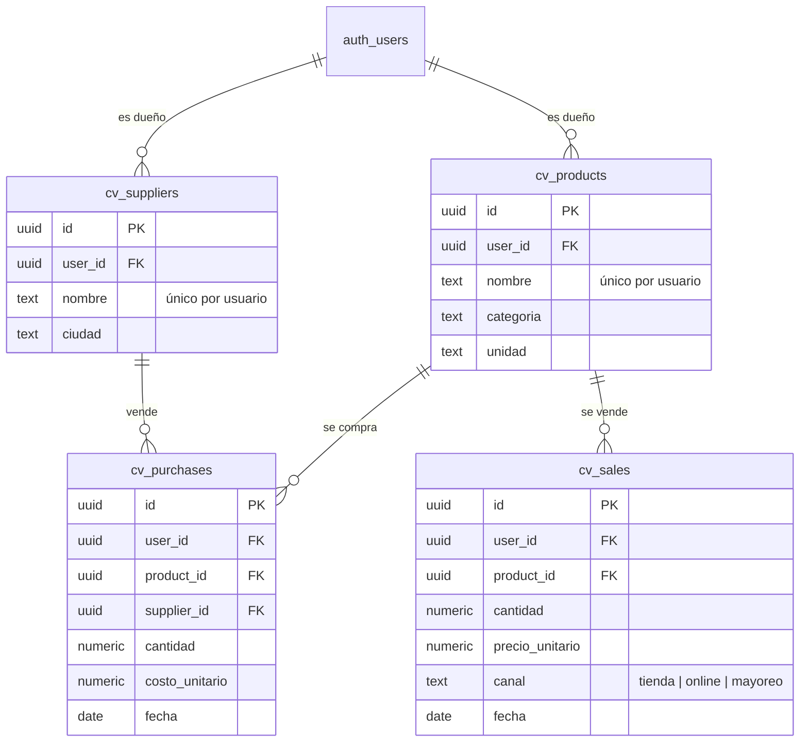

# CompraVenta Insights

Dashboard para analizar compras y ventas. Registras (o importas desde CSV) lo que compras a tus proveedores
y lo que vendes, y la app calcula el **margen y la utilidad de cada producto**. También te dice **qué proveedor
te vende más barato cada producto** y cuánto habrías ahorrado comprándole siempre a él.

> Proyecto de portfolio: los cálculos viven en SQL (vistas con `security_invoker`, funciones de ventana como
> `rank() over (...)` y funciones RPC). La app los muestra con Recharts.

## Capturas

| Dashboard | Benchmark | Márgenes |
|---|---|---|
|  |  |  |

_(Las capturas son placeholders: agrégalas en `docs/` después del primer deploy.)_

## Funcionalidades

- **Dashboard**:
  - KPIs del periodo: ventas, compras, utilidad bruta y margen, cada uno comparado contra el periodo anterior
    de la misma duración.
  - Filtro de rango de fechas con atajos (30 días, 90 días, 6 meses y 1 año).
  - Gráficas: línea de ventas vs compras (y utilidad) por mes, barras con el top 10 de productos por utilidad
    y dona de ventas por canal.
- **Benchmark de proveedores**:
  - Elige un producto y compara a sus proveedores: costo promedio ponderado, mínimo y máximo, número de compras,
    **ranking** y % de diferencia contra el más barato.
  - El mejor precio aparece resaltado y cada proveedor muestra su **ahorro potencial**.
  - Resumen de ahorro total y una tabla con el mejor proveedor de cada producto.
- **Márgenes**: tabla que se ordena por cualquier columna, con **alertas para productos con margen menor a 15 %**
  y un filtro para ver solo esos.
- **Registros**: CRUD de compras, ventas, productos y proveedores, con filtros por fecha y producto y paginación.
- **Importar CSV**: plantilla descargable, arrastrar y soltar, y una **vista previa con validación por fila**
  antes de guardar. Los productos y proveedores que no existen se crean solos. Acepta fechas `AAAA-MM-DD` o
  `DD/MM/AAAA` y montos con `$` y comas.
- UI en español, móvil primero, modo claro y oscuro, estados de carga y vacío, y toasts.

## Cómo se calcula

| Métrica | Fórmula (en SQL) |
|---|---|
| Costo promedio ponderado | `Σ(cantidad × costo_unitario) / Σ cantidad` de todas las compras del producto |
| Precio promedio | `Σ(cantidad × precio_unitario) / Σ cantidad` de las ventas |
| Margen % | `(precio promedio − costo promedio) / precio promedio × 100` |
| Utilidad | `ventas − unidades vendidas × costo promedio ponderado` |
| Ranking de proveedor | `rank() over (partition by product_id order by avg_cost)` |
| % vs. mejor | `(avg_cost − min(avg_cost) over (partition by product_id)) / min(...) × 100` |
| Ahorro potencial | `unidades compradas × (avg_cost − mejor avg_cost)` |

Objetos SQL:

- `cv_product_cost` (vista): costo promedio ponderado por producto.
- `cv_product_margin` (vista): margen y rentabilidad por producto.
- `cv_supplier_benchmark` (vista): comparación de proveedores con ranking.
- `cv_monthly_summary(p_from, p_to)` (RPC): compras, ventas, costo de lo vendido y utilidad por mes.
- `cv_dashboard(p_from, p_to)` (RPC): KPIs, top 10 productos y ventas por canal en un JSON.

Todas las vistas usan `security_invoker = true`, así que respetan el RLS de las tablas base:
**cada usuario solo ve sus propios datos**. Un trigger también impide que una compra o venta apunte a un
producto o proveedor de otro usuario.

## Stack

- **Next.js 16** (App Router, Server Components, Server Actions, `proxy.ts`) + TypeScript estricto
- **Tailwind CSS v4** + **shadcn/ui** (Base UI) + `lucide-react`
- **Supabase**: Postgres, Auth y RLS, con `@supabase/ssr`
- **Zod** (se valida en el navegador para la vista previa y otra vez en el servidor)
- **Recharts** y **Papa Parse**
- Deploy en **Vercel**

## Modelo de datos



## Correr en local

Requisitos: Node 20+ y un proyecto de Supabase. Se comparte la base con otros proyectos del portfolio,
por eso todo lleva el prefijo `cv_`.

1. **Instala dependencias**
   ```bash
   npm install
   ```
2. **Variables de entorno**: copia `.env.example` a `.env.local` y llena los valores de
   Supabase → Project Settings → API (`NEXT_PUBLIC_SUPABASE_URL` y `NEXT_PUBLIC_SUPABASE_ANON_KEY`).
3. **Crea el usuario demo** en Supabase → Authentication → Users → *Add user*:
   `demo@portfolio.dev` / `Demo1234!`, marcando *Auto Confirm User*. Si ya existe por otro proyecto, sáltate este paso.
4. **Crea el esquema**: en Supabase → SQL Editor ejecuta `supabase/migrations/0001_init.sql`.
5. **Carga los datos demo**: ejecuta `supabase/seed.sql`. Crea 15 productos, 4 proveedores con precios distintos
   y unos 6 meses de compras y ventas con estacionalidad (390 compras y 1,350 ventas). Puedes volver a correrlo:
   solo borra y recrea los datos `cv_` del usuario demo.
6. **Arranca**
   ```bash
   npm run dev
   ```
   Abre http://localhost:3001 y presiona **"Entrar como demo"**.

## Desplegar en Vercel

1. Sube el repo a GitHub.
2. En Vercel → *Add New Project* importa el repositorio (framework: Next.js).
3. Agrega `NEXT_PUBLIC_SUPABASE_URL` y `NEXT_PUBLIC_SUPABASE_ANON_KEY` en *Environment Variables*.
4. Deploy.
5. En Supabase → Authentication → URL Configuration agrega la URL de Vercel en *Site URL* y en *Redirect URLs*.

## Credenciales demo

| Correo | Contraseña |
|---|---|
| `demo@portfolio.dev` | `Demo1234!` |

## Siguientes pasos

- Proyecciones de ventas y compras (tendencia y estacionalidad).
- Exportar reportes a PDF.
- Alertas por correo cuando un margen baje del umbral o un proveedor suba su precio (con `pg_cron`).
- Costo por método PEPS en lugar de promedio ponderado.
